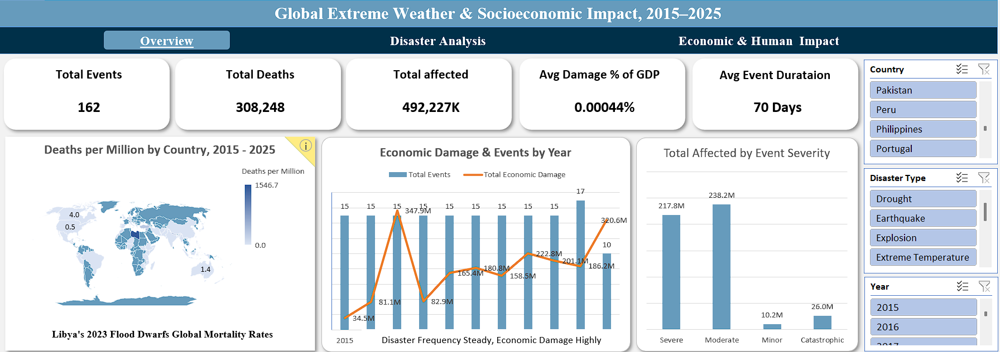

# Global Extreme Weather & Socioeconomic Impact (2015–2025)

An Excel-based data analytics project exploring global extreme weather events and their socioeconomic consequences from 2015 to 2025. The project uses **Excel Power Query, Power Pivot, data modeling, DAX measures, and interactive PivotChart dashboards** to analyze disaster frequency, human casualties, economic damage, and differences across countries, regions, and income groups.

## Project Overview

Extreme weather and other disasters can cause loss of life, population displacement, and substantial economic damage. This project transforms historical disaster data into an interactive reporting solution to help users understand disaster patterns and compare their impacts across different geographical and socioeconomic dimensions.

## Dashboard Pages

### 1. Overview

Provides a high-level summary of disaster events and their impacts.

- Total disaster events, deaths, affected population, average damage as a percentage of GDP, and average event duration.
- Deaths per million people by country.
- Annual trends in disaster frequency and economic damage.
- Population affected by event severity.
- Interactive country, disaster type, and year filters.

### 2. Disaster Analysis

Examines disaster frequency, severity, and consequences by disaster type and category.

- Event frequency by disaster type and category.
- Death toll by disaster type.
- Economic damage by disaster type and category.
- Distribution of events across severity levels.
- Interactive filters for country, disaster type, disaster category, and year.

### 3. Economic & Human Impact

Explores how disaster consequences differ across countries and socioeconomic groups.

- Top 10 countries by economic damage.
- Economic damage by severity class.
- Economic damage across World Bank income groups.
- Deaths per million people by income group.
- Total displaced population by region.
- Percentage of population affected by region.

### 4. Data Model

The Power Pivot data model separates descriptive dimensions from the central disaster-event fact table.

- **Fact table:** Stores disaster-event records and associated measures.
- **Dim_country:** Supports country-level analysis and country-year identification.
- **Dim_date:** Supports time-based analysis by date, month, and year.
- **Dim_disaster_type:** Organizes disasters by type, category, and group.
- **Measures table:** Organizes DAX measures used in dashboard calculations.

The relationships connect the dimension tables to the fact table, enabling consistent filtering and analysis across report pages.

## Tools & Technologies

- **Microsoft Excel:** Reporting and dashboard development.
- **Power Query:** Data preparation and transformation.
- **Power Pivot:** Data modeling and relationship management.
- **DAX:** Measures and KPI calculations.
- **PivotTables & PivotCharts:** Interactive visualizations and comparative analysis.
- **Slicers:** Dynamic filtering by geographical, temporal, and disaster-related attributes.

## Key Findings

1.  Libya facing the most deaths per million - 1546.7 deaths per million. 
2.  Flood is the most occouring disaster type - 53 Tiemes.
3.  Extreme Temperature causing the most deaths - 189.7K.
4.  Hurricanes causing the most economic damage - 613.2 Million.
5.  United States faces the most economic damage - 762.5M.
6.  Moderate Severity type disasters causing the most economic damage.
7.  High Income groups face the most damage while Low Income Groups face the most deaths.
8.  11 Millions people displaced in Asia.
9.  Mateorological events causing the most economic damage and share 33% of events frequency.
10. Overall Africa, being the most affected region in terms of economic loss and deaths.

## Business & Social Value

This project demonstrates how historical disaster data can be transformed into a structured analytical model and interactive reporting solution.

The analysis can support:
- **Risk assessment:** Identify disaster types associated with substantial human and economic consequences.
- **Resource allocation:** Understand where reported impacts are concentrated.
- **Socioeconomic comparison:** Examine differences in disaster outcomes across regions and income groups.
- **Trend monitoring:** Track changes in disaster frequency and damage over time.
- **Data-driven decision-making:** Present complex historical information through accessible visualizations.

## Skills Demonstrated

· `Excel` · `Power Query` · `Power Pivot` · `DAX` · `Data Modeling` · `Data Cleaning` · `Data Visualization` · `Exploratory Data Analysis` · `Interactive Dashboards` 
· `Business KPIs`

## Repository Contents

- `Weather Socioeconomic Project 2015-2025.xlsx` — Excel workbook containing the analytical model, measures, and dashboards.
- `Images/Overview.png` — Overview dashboard screenshot.
- `Images/Disaster Analysis.png` — Disaster analysis dashboard screenshot.
- `Images/Economic & Human Impact.png` — Economic and human impact dashboard screenshot.
- `Images/Data Modeling.png` — Power Pivot data model screenshot.

## Disclaimer

This project is intended for analytical and educational purposes. Findings represent the data available in the underlying dataset and should be interpreted in the context of its coverage, definitions, and limitations.

## Important Note
- .csv file is the dataset that .xlsx file is accessing in the power query and applying all transformations downstream based on that.
- Download both files in project folder (.xlsx file and .csv file) and set path of csv file in power query advanced editor to run project on your local computer.